# kooper-teddies-notes

A study guide for everything this project has taught so far, and how the pieces connect.
Concepts only: no real data, no tokens. Updated with each PR that teaches something new.

**Contents**
1. [The big picture](#1-the-big-picture)
2. [Local platform: Mac → VM → nodes → pods](#2-local-platform-mac--vm--nodes--pods)
3. [The control plane and the reconcile loop](#3-the-control-plane-and-the-reconcile-loop)
4. [Workloads: Pod, Deployment, ReplicaSet, StatefulSet, DaemonSet](#4-workloads)
5. [Rolling updates and rollbacks](#5-rolling-updates-and-rollbacks)
6. [Networking: Services, DNS, kube-proxy](#6-networking-services-dns-kube-proxy)
7. [Storage: PVC, PV, StorageClass](#7-storage-pvc-pv-storageclass)
8. [Images and the supply chain](#8-images-and-the-supply-chain)
9. [TLS, certificates and CAs](#9-tls-certificates-and-cas)
10. [Identity: kubeconfig, ServiceAccounts, JWTs](#10-identity-kubeconfig-serviceaccounts-jwts)
11. [Secrets pipeline: Vault + External Secrets Operator](#11-secrets-pipeline-vault--external-secrets-operator)
12. [etcd and encryption at rest](#12-etcd-and-encryption-at-rest)
13. [Extending Kubernetes: Helm, CRDs, admission webhooks](#13-extending-kubernetes-helm-crds-admission-webhooks)
14. [Break-it log: what failed and what it taught](#14-break-it-log)
15. [Security one-liners (interview)](#15-security-one-liners-interview)
16. [Command cheat sheet](#16-command-cheat-sheet)

---

## 1. The big picture

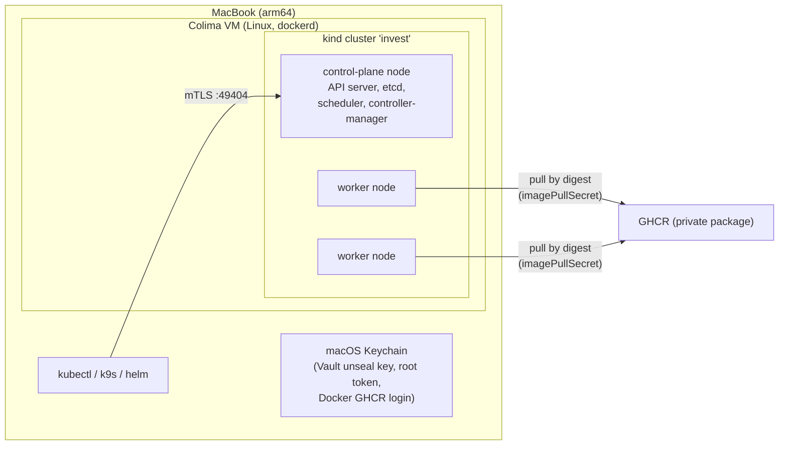

What runs in the cluster today:

| Namespace | What | Kind of object |
|---|---|---|
| `invest` | portfolio-api (2 replicas), Service, `eso-vault` SA, SecretStore, ExternalSecret → Secret `ghcr-pull` | Deployment, Service, CRDs |
| `vault` | HashiCorp Vault (standalone, file storage on a PVC) | StatefulSet (Helm) |
| `external-secrets` | External Secrets Operator: controller, webhook, cert-controller | Deployments (Helm) |
| `kube-system` | API server, etcd, scheduler, controller-manager (static pods), kube-proxy + kindnet (DaemonSets), CoreDNS | mixed |

---

## 2. Local platform: Mac → VM → nodes → pods

macOS can't run Linux containers natively, so there are layers:

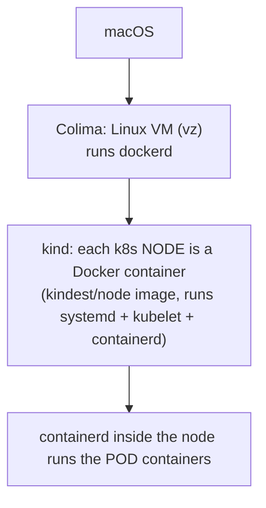

- **Colima** = the Linux VM + Docker engine. `colima start/stop`.
- **kind** = Kubernetes IN Docker. A node is just a container; all nodes share the VM's kernel.
- When Colima starts, Docker restarts the node containers (restart policy), the control plane's **static pods** come up from `/etc/kubernetes/manifests`, and the cluster state comes back from **etcd** on disk.
- `kind load docker-image` copies an image into each node's containerd. It's not a registry.

---

## 3. The control plane and the reconcile loop

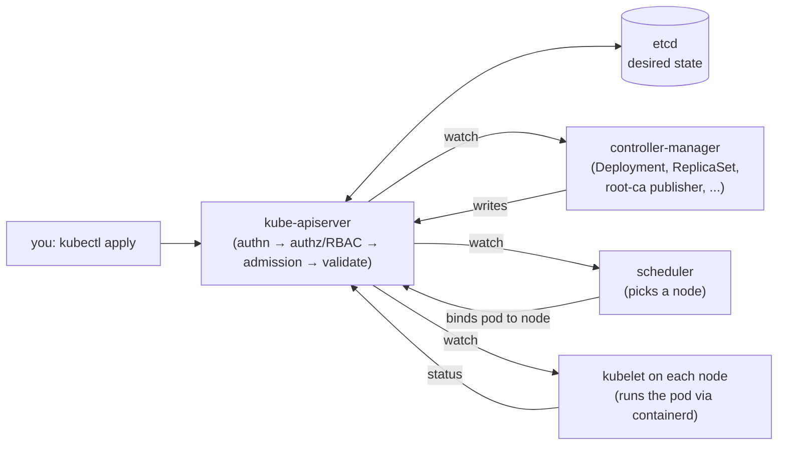

- **Only the API server talks to etcd.** Everything else reads and writes objects through it.
- **Reconcile loop:** every controller compares *desired* (spec, in etcd) with *actual* (status) and acts on the difference. Kubernetes is a pile of these loops.
- **spec vs status:** you write `spec`; controllers write `status`. `metadata.generation` bumps on every spec change; `status.observedGeneration` shows the controller caught up.
- **Static pods:** kubelet runs any manifest in `/etc/kubernetes/manifests` directly. That's how the control plane bootstraps itself.
- **Controllers back off:** after repeated failures a controller waits longer each time (exponential, ~16 min cap). Any change to the object (e.g. an annotation) triggers an immediate retry.

---

## 4. Workloads

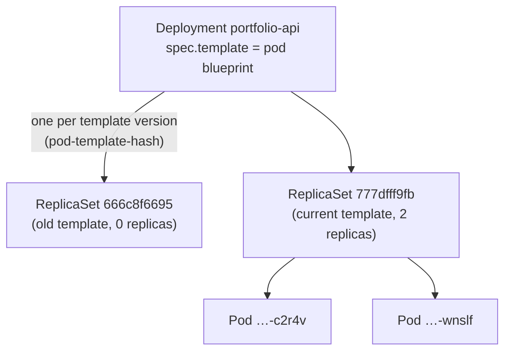

| Object | Use it for | Key trait |
|---|---|---|
| **Pod** | one or more containers sharing an IP and volumes | disposable; never run bare |
| **ReplicaSet** | "keep N pods of this template" | created by a Deployment; holds a frozen template |
| **Deployment** | stateless apps (portfolio-api) | rolling updates, rollback, random pod names |
| **StatefulSet** | stateful apps (Vault, later Postgres) | stable names (`vault-0`), one PVC per pod, ordered start |
| **DaemonSet** | one pod per node (kube-proxy, kindnet) | node agents |

- **Labels are routing, not identity.** Deployment `selector`, Service `selector` and the template's labels must line up. Anyone who can create pods in the namespace can add a matching label and receive Service traffic.
- `containers:` is a list. One entry = one process from one image. The container `name` is ours to pick; pod names are generated.
- Every pod gets a ServiceAccount token mounted by default (`kube-api-access-*`). Turn it off with `automountServiceAccountToken: false` when the app doesn't call the API.
- No `resources` set → QoS `BestEffort` → first to be evicted under memory pressure.

---

## 5. Rolling updates and rollbacks

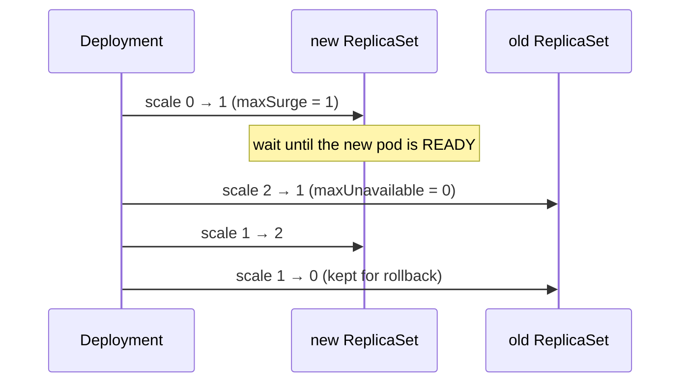

- Defaults: `maxSurge 25%` (rounded up) and `maxUnavailable 25%` (rounded down). With 2 replicas that's +1 / −0.
- A broken new version (e.g. `ImagePullBackOff`) **never removes old pods**: the rollout just stalls. After `progressDeadlineSeconds` it's marked failed, but it does **not** auto-rollback.
- Without a **readiness probe**, "Ready" only means "the container started". A version that starts but returns errors would still roll out. (Probes: step 6.)
- `kubectl rollout undo` scales the previous ReplicaSet back up. It **creates a new revision** (history only moves forward) and causes **drift**: the cluster no longer matches git. Fix git (`git revert`) or `kubectl apply` the file again. With Argo CD, rollback = `git revert`.

---

## 6. Networking: Services, DNS, kube-proxy

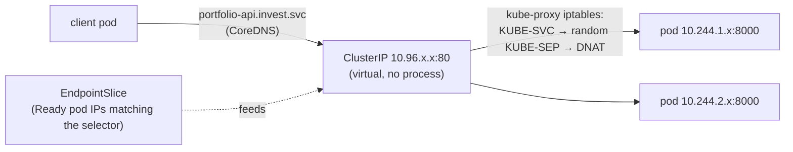

- **Service** = a stable virtual IP + DNS name in front of changing pod IPs. Ranges: Services `10.96.0.0/16`, pods `10.244.0.0/16`.
- **EndpointSlice** lists the Ready pods behind it. No Ready pods → kube-proxy REJECTs → `connection refused` (curl exit 7). DNS failure is a different error (exit 6).
- **Headless Service** (`clusterIP: None`): no virtual IP; DNS returns pod IPs and gives StatefulSet pods stable names (`vault-0.vault-internal`).
- `kubectl port-forward` tunnels **through the API server** (RBAC `pods/portforward`).

---

## 7. Storage: PVC, PV, StorageClass

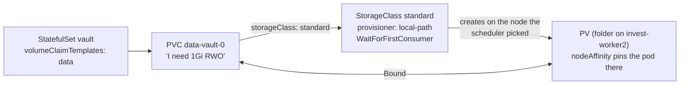

- **PVC** = a request (namespaced). **PV** = actual storage (cluster-wide). **StorageClass** = how to create PVs on demand. App YAML stays portable; only the StorageClass changes between kind and EKS (EBS).
- **WaitForFirstConsumer**: the scheduler places the pod first, then the volume is created on that node / in that AZ. After that, the volume pins the pod.
- PVC name = `<template>-<statefulset>-<ordinal>` → `data-vault-0`. A replaced `vault-0` gets the same PVC back.
- Deleting a StatefulSet keeps its PVCs (Kubernetes doesn't garbage-collect your data). Reclaim policy `Delete` vs `Retain` decides what happens to the PV when the PVC is deleted.
- local-path volumes are plain 0777 folders on one node: fine for a laptop, no node-failure tolerance.

---

## 8. Images and the supply chain

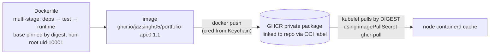

- **Tag vs digest:** a tag can be moved to another image; a digest (`@sha256:…`) can't. Deploy by digest.
- Short names expand to `docker.io/library/...`, a supply-chain risk.
- **Layer cache is a chain:** changing step N rebuilds N+1 onward. Put slow, stable steps (base, dependencies) first.
- `docker login` without a credential helper stores `base64(user:token)` in `~/.docker/config.json`. With `credsStore: osxkeychain` the file holds no secret.
- **Registry token flow:** containerd asks `ghcr.io/token?scope=repository:…:pull` for a short-lived bearer token. Anonymous → 401 for a private package; with the pull secret → Basic auth → token → download.
- Each node pulls and caches separately (`IfNotPresent`: no pull if cached). A running container doesn't need its image anymore (it runs from an unpacked snapshot).
- **Publisher credential ≠ cluster credential:** laptop gh token has `write:packages`; the cluster's PAT has only `read:packages` and expires.

---

## 9. TLS, certificates and CAs

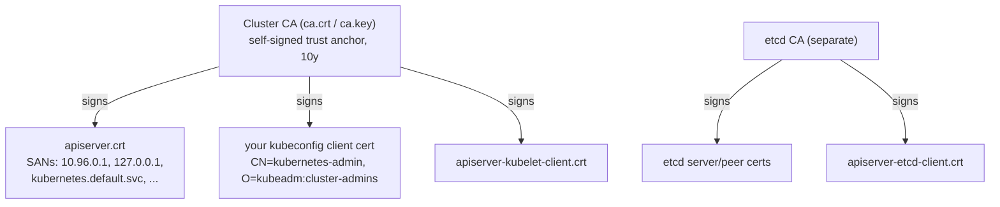

- A **certificate** = a CA-signed statement "this public key belongs to this name". Like a JWT, but for keys.
- **Verifying a cert:** signature by a trusted CA + valid dates + the name you dialed is in the **SAN** list + the server proves it holds the private key.
- **mTLS** = both sides show certs. kubectl ↔ API server, API server ↔ kubelet, API server ↔ etcd are all mTLS.
- The same CA cert is in three places: the node's `pki/` (created by `kubeadm init`), the `kube-root-ca.crt` ConfigMap in every namespace (projected into every pod as `ca.crt`), and your kubeconfig. The CA cert is public; **`ca.key` is the crown jewel** (mint any user). K8s client certs **can't be revoked**.
- `openssl s_client` without the CA → "unable to verify" (code 21). Never skip verification (`-k`, `insecureSkipTLSVerify`).

---

## 10. Identity: kubeconfig, ServiceAccounts, JWTs

- **kubeconfig** = clusters (URL + CA) + users (client cert or token) + contexts. Your user is a cert in group `kubeadm:cluster-admins` → bound to `cluster-admin`. `system:masters` is break-glass only.
- **ServiceAccount** = an identity for workloads. Its tokens are **JWTs** signed by the API server's `sa.key`.
- **JWT** = `header.payload.signature`. The payload is readable by anyone (`iss`, `sub`, `aud`, `exp`, `jti`, SA `uid`); the signature makes it tamper-proof. It's a **bearer token**: whoever holds it is that identity until `exp`.
- **TokenRequest** (`kubectl create token`) mints short-lived, **audience-bound** tokens. Deleting and recreating an SA changes its UID and revokes all its old tokens.

---

## 11. Secrets pipeline: Vault + External Secrets Operator

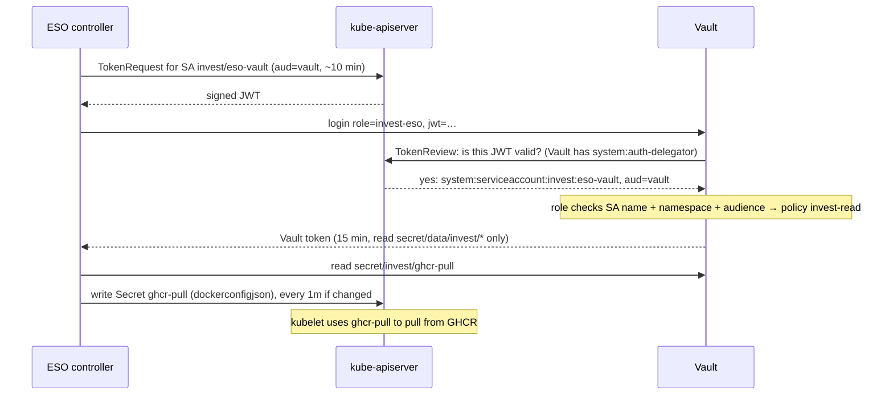

- **Vault:** standalone StatefulSet; KV v2 at `secret/` (versioned; real API path has `/data/`). Starts **sealed** after every restart; unseal key + root token live in macOS Keychain, never printed. Production: HA + **auto-unseal with KMS**.
- **No secret zero:** ESO never holds a long-lived Vault credential. It proves identity with a cluster-signed JWT; Vault asks the cluster to verify it. Same pattern as EKS Pod Identity / IRSA and GitHub Actions OIDC.
- **Client names the role, server decides the policy.** The SecretStore says `role: invest-eso`; Vault attaches `invest-read`. Clients can't pick their own permissions.
- **Per-namespace tenancy:** namespaced `SecretStore` + dedicated SA `invest/eso-vault` + Vault path `secret/invest/*` + policy `invest-read`. Not ESO's own SA, which would let any namespace read anything.
- **`audience=vault`:** a token minted for the k8s API (like the one auto-mounted in pods) is rejected by Vault → no replay.
- **Trust is transitive:** whoever can mint a token for `invest/eso-vault` can read `secret/invest/*`. Guard `serviceaccounts/token` and pod creation.
- **ExternalSecret** fetches `username` + `token` and templates them into Docker's `config.json` format (`kubernetes.io/dockerconfigjson`), the only format kubelet accepts for pull secrets. ESO only writes when the data hash changes.

---

## 12. etcd and encryption at rest

- **etcd** = the cluster's key-value database. Keys look like `/registry/<resource>/<namespace>/<name>`. Lose it and the cluster forgets everything; back it up.
- By default Secrets in etcd are **base64, not encrypted**. Reading etcd directly (node root, etcd client certs, a backup file) shows every Secret, with no RBAC or audit in the way.
- **Encryption at rest:** an `EncryptionConfiguration` makes the API server encrypt Secrets before writing them (`k8s:enc:secretbox:v1:key1:…` in etcd). `scripts/enable-etcd-encryption.sh` does this with a local key; the key sits on the node, so it protects backups and snapshots, not node root.

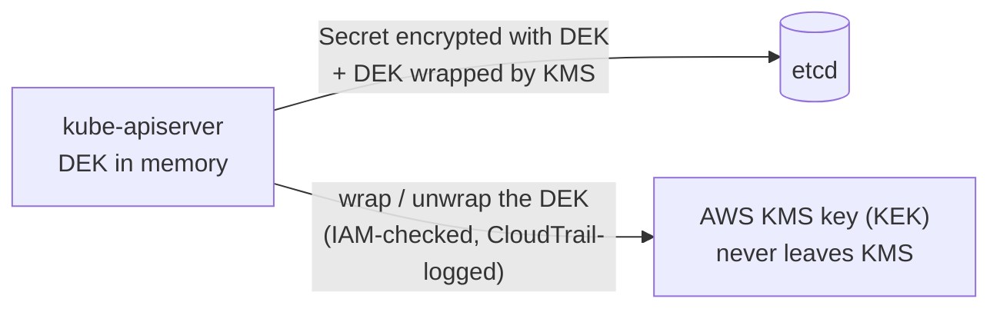

- **On EKS: envelope encryption with your own KMS key.** A data key (DEK) encrypts Secrets; the KMS key (KEK) wraps the DEK and never leaves KMS. Stealing etcd isn't enough; you also need IAM permission to call KMS. Disabling the key makes the data unreadable.
- **Encryption at rest protects storage, not the API.** Anyone with RBAC `get`/`list` on Secrets still reads them decrypted. `list` returns full contents too.
- Full picture: **ESO** = distribution + rotation, **KMS** = storage, **RBAC + audit** = access.

---

## 13. Extending Kubernetes: Helm, CRDs, admission webhooks

- **Helm chart ≈ Terraform module:** templates + `values.yaml` defaults; you pass your own values and pin `--version`. Helm tracks a **release** (stored as a Secret) so upgrades remove dropped objects and rollbacks work. `helm install --dry-run=server` validates against the API server without changing anything.
- **Our app = plain YAML + kubectl** (to learn the objects). **Third-party software = Helm** (ESO is ~34k lines rendered). Our own chart comes in step 7.
- **Namespaces are owned by YAML files**, not `helm --create-namespace`, so they can carry labels (Pod Security Admission later).
- **CRD = a new noun, controller = the verb.** ESO added 25 CRDs (`SecretStore`, `ExternalSecret`, …). A CRD object on its own is just data in etcd; the controller gives it behavior and writes its `status`.
- **Validating admission webhook:** the API server calls it (over TLS) before saving an object. ESO's uses `failurePolicy: Fail` = fail-closed: if the webhook is down, writes to ESO objects are rejected. Status updates and syncing keep working. Run webhooks with 2+ replicas and a PDB, and keep their scope narrow.

---

## 14. Break-it log

| Broke | What happened | Lesson |
|---|---|---|
| Deleted a pod | ReplicaSet made a new one | Controllers enforce desired count |
| Bare pod deleted | Gone for good | Never run bare pods |
| Image not on nodes | `ImagePullBackOff` | kubelet retries with backoff |
| Scaled to 0 | Service REJECTs (exit 7) | No Ready endpoints = no traffic |
| Private image, no pull secret | 401 from GHCR token endpoint; old pods kept serving | Rollouts don't remove capacity until new pods are Ready |
| Vault sealed | ESO not Ready, existing Secret kept, app fine | Vault down = refresh outage, not app outage; alert on `READY False` |
| Vault unsealed | ESO stayed broken for minutes | Exponential backoff; nudge (annotate) or restart the controller |
| Rotated the token | Synced in <1 min; forced pull on a cache-less node worked; old PAT revoked | Zero-downtime rotation: add new → verify → revoke old |
| Deleted Secret `ghcr-pull` | Recreated in the same second | Owned Secrets are watched; Vault is the source of truth |
| ESO webhook scaled to 0 | Writes to ESO objects rejected | Fail-closed admission is an availability dependency |
| Read etcd directly | Token in plaintext | Enable encryption at rest (KMS on EKS) |
| `rollout undo` | Old ReplicaSet scaled up as a new revision; git ≠ cluster | Emergency button; then make git match |

---

## 15. Security one-liners (interview)

- "Workloads authenticate with platform-issued, audience-bound, short-lived identity tokens; no static credentials anywhere."
- "The client asserts identity; the server decides permissions."
- "ESO solves distribution and rotation, KMS envelope encryption solves storage, RBAC plus audit solves access. You need all three."
- "Labels are routing, not identity."
- "Every pod gets an API token by default; turn it off where it isn't needed."
- "Pin images by digest; tags are mutable."
- "`ca.key`, `etcd/ca.key` and `sa.key` on a control-plane node are game over. That's why managed control planes hide them."
- "Fail-closed admission is secure but becomes an availability dependency."

---

## 16. Command cheat sheet

```bash
# cluster / state
kubectl get nodes -o wide
kubectl get all -n invest
kubectl describe pod <pod> -n invest          # Events at the bottom explain most failures
kubectl get events -n invest --sort-by=.lastTimestamp
kubectl diff -f <file> && kubectl apply -f <file>

# rollouts
kubectl rollout status|history|undo deployment/portfolio-api -n invest

# nodes
kubectl cordon|uncordon <node>
docker exec <node> crictl images              # node-level view under k8s

# Vault (after every colima start)
security find-generic-password -a vault -s kind-invest-vault-unseal -w | tr -d '\n' \
  | kubectl exec -i -n vault vault-0 -- vault write sys/unseal key=-

# ESO
kubectl get secretstore,externalsecret -n invest
kubectl annotate externalsecret ghcr-pull -n invest force-sync=$(date +%s) --overwrite
```

zsh tip: single-quote any argument containing `[ ]`, `?` or `*` (jsonpath, custom-columns).
