# kooper-teddies-notes

A study guide for everything this project has taught so far, and how the pieces connect.
Concepts only: no real data, no tokens. Updated with each PR that teaches something new.

**Contents**
1. [The big picture](#1-the-big-picture)
2. [Local platform: Mac → VM → nodes → pods](#2-local-platform-mac--vm--nodes--pods)
3. [The control plane and the reconcile loop](#3-the-control-plane-and-the-reconcile-loop)
4. [Workloads: Pod, Deployment, ReplicaSet, StatefulSet, DaemonSet](#4-workloads)
5. [Rolling updates and rollbacks](#5-rolling-updates-and-rollbacks)
6. [Networking: Services, DNS, kube-proxy](#6-networking-services-dns-kube-proxy)
7. [Storage: PVC, PV, StorageClass](#7-storage-pvc-pv-storageclass)
8. [Images and the supply chain](#8-images-and-the-supply-chain)
9. [TLS, certificates and CAs](#9-tls-certificates-and-cas)
10. [Identity: kubeconfig, ServiceAccounts, JWTs](#10-identity-kubeconfig-serviceaccounts-jwts)
11. [Secrets pipeline: Vault + External Secrets Operator](#11-secrets-pipeline-vault--external-secrets-operator)
12. [etcd and encryption at rest](#12-etcd-and-encryption-at-rest)
13. [Extending Kubernetes: Helm, CRDs, admission webhooks](#13-extending-kubernetes-helm-crds-admission-webhooks)
14. [Break-it log: what failed and what it taught](#14-break-it-log)
15. [Security one-liners (interview)](#15-security-one-liners-interview)
16. [Command cheat sheet](#16-command-cheat-sheet)
17. [Postgres: ConfigMaps, volumes, least-privilege users](#17-postgres-configmaps-volumes-least-privilege-users)
18. [Live config: the sheet header map](#18-live-config-the-sheet-header-map)
19. [TLS to Postgres, simply: the ID badge system (plan)](#19-tls-to-postgres-simply-the-id-badge-system-plan)

---

## 1. The big picture

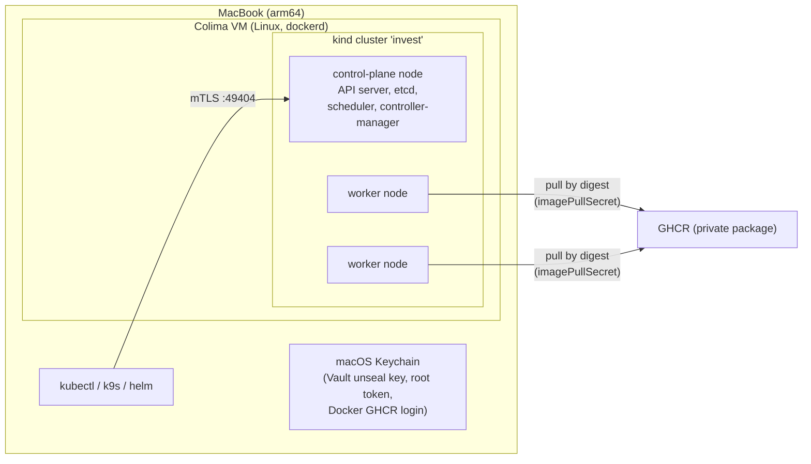

What runs in the cluster today:

| Namespace | What | Kind of object |
|---|---|---|
| `invest` | portfolio-api (2 replicas), Service, `eso-vault` SA, SecretStore, ExternalSecret → Secret `ghcr-pull` | Deployment, Service, CRDs |
| `vault` | HashiCorp Vault (standalone, file storage on a PVC) | StatefulSet (Helm) |
| `external-secrets` | External Secrets Operator: controller, webhook, cert-controller | Deployments (Helm) |
| `kube-system` | API server, etcd, scheduler, controller-manager (static pods), kube-proxy + kindnet (DaemonSets), CoreDNS | mixed |

---

## 2. Local platform: Mac → VM → nodes → pods

macOS can't run Linux containers natively, so there are layers:

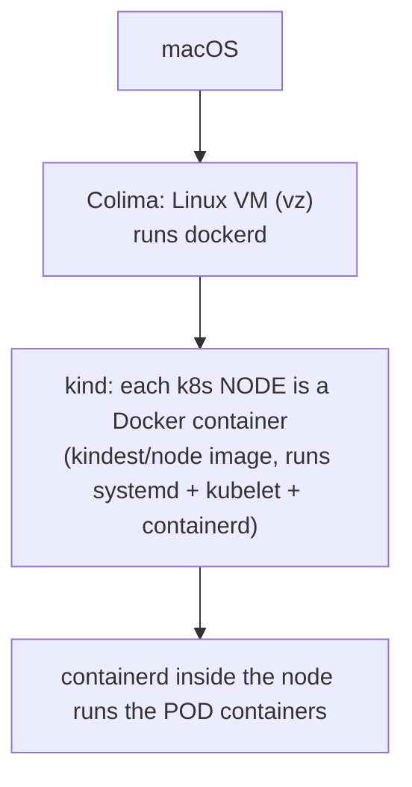

- **Colima** = the Linux VM + Docker engine. `colima start/stop`.
- **kind** = Kubernetes IN Docker. A node is just a container; all nodes share the VM's kernel.
- When Colima starts, Docker restarts the node containers (restart policy), the control plane's **static pods** come up from `/etc/kubernetes/manifests`, and the cluster state comes back from **etcd** on disk.
- `kind load docker-image` copies an image into each node's containerd. It's not a registry.

---

## 3. The control plane and the reconcile loop

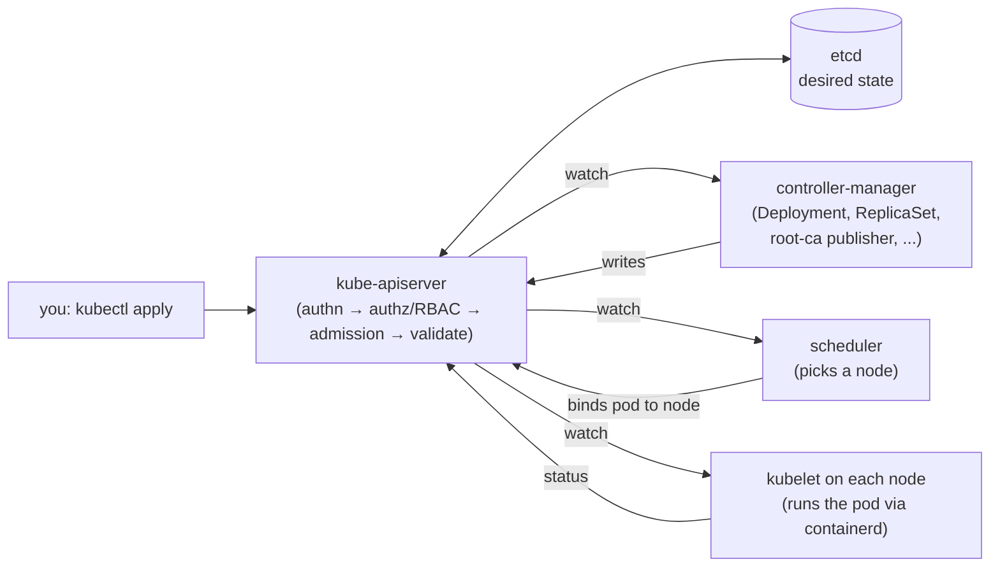

- **Only the API server talks to etcd.** Everything else reads and writes objects through it.
- **Reconcile loop:** every controller compares *desired* (spec, in etcd) with *actual* (status) and acts on the difference. Kubernetes is a pile of these loops.
- **spec vs status:** you write `spec`; controllers write `status`. `metadata.generation` bumps on every spec change; `status.observedGeneration` shows the controller caught up.
- **Static pods:** kubelet runs any manifest in `/etc/kubernetes/manifests` directly. That's how the control plane bootstraps itself.
- **Controllers back off:** after repeated failures a controller waits longer each time (exponential, ~16 min cap). Any change to the object (e.g. an annotation) triggers an immediate retry.

---

## 4. Workloads

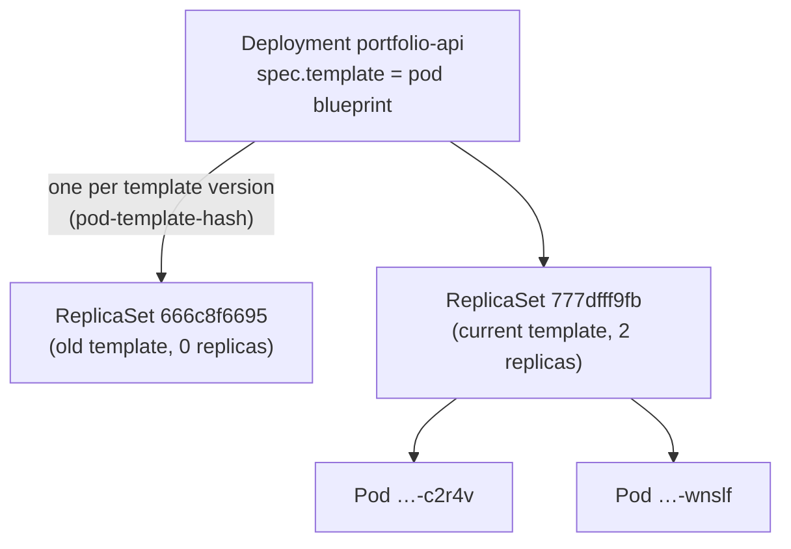

| Object | Use it for | Key trait |
|---|---|---|
| **Pod** | one or more containers sharing an IP and volumes | disposable; never run bare |
| **ReplicaSet** | "keep N pods of this template" | created by a Deployment; holds a frozen template |
| **Deployment** | stateless apps (portfolio-api) | rolling updates, rollback, random pod names |
| **StatefulSet** | stateful apps (Vault, Postgres) | stable names (`vault-0`, `postgres-0`), one PVC per pod, ordered start |
| **DaemonSet** | one pod per node (kube-proxy, kindnet) | node agents |

- **Labels are routing, not identity.** Deployment `selector`, Service `selector` and the template's labels must line up. Anyone who can create pods in the namespace can add a matching label and receive Service traffic.
- `containers:` is a list. One entry = one process from one image. The container `name` is ours to pick; pod names are generated.
- **`replicas` = how many pods; the `containers:` list = how many containers in EACH pod.** Every replica is an identical copy of the template. 2 replicas × 2 containers = 4 containers. `READY 1/1` = ready containers / containers in that pod.
- Two containers share a pod only when they must live together (same IP via `localhost`, shared volumes, start and die together): a **sidecar** like a log shipper, proxy or Vault Agent. Independent services (portfolio-api, Postgres) always get separate pods so they scale and restart separately.
- **Update strategies:** Deployments and StatefulSets default to `RollingUpdate` (replace pods as soon as the template changes). The Vault chart uses **`OnDelete`**: the template updates, but the pod is only replaced when you delete it, because a restarted Vault comes up sealed.
- Every pod gets a ServiceAccount token mounted by default (`kube-api-access-*`). Turn it off with `automountServiceAccountToken: false` when the app doesn't call the API.
- No `resources` set → QoS `BestEffort` → first to be evicted under memory pressure.

---

## 5. Rolling updates and rollbacks

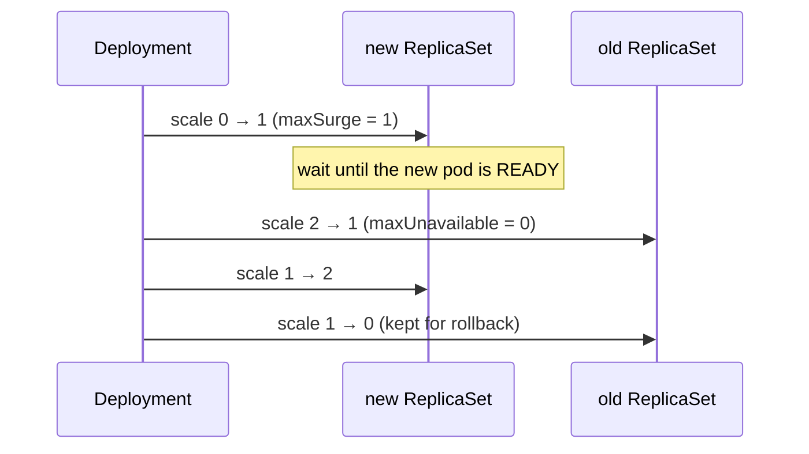

**Template change vs replica change.** The Deployment hashes only `spec.template`:

| You change | New ReplicaSet? | What happens |
|---|---|---|
| `spec.template` (image, labels, env, imagePullSecrets…) | **Yes** (new hash) | Rolling update → new revision; old ReplicaSet kept at 0 for rollback |
| `spec.replicas` | **No** | The current ReplicaSet is scaled. No rollout, no new revision (that's why an HPA can scale freely) |

**Who owns what.** We never write ReplicaSets. The Deployment controller creates one per template version (name = `<deployment>-<pod-template-hash>`), copies the template into it, and sets an `ownerReference` back to the Deployment. The Deployment keeps the last `revisionHistoryLimit` (default 10) old ReplicaSets; you can't roll back past those. Don't edit a ReplicaSet directly; change the Deployment.

**Rollback is done by the Deployment.** `kubectl rollout undo deployment/x` copies an old ReplicaSet's template back into the Deployment's `spec.template`, then the normal rolling update runs. A ReplicaSet has no history of its own. In k9s, "Rollback" (`ctrl-l`) sits on the ReplicaSet view only as a picker: each row is a revision, and k9s tells the owning Deployment to go back to it (same as `--to-revision=N`).

- Defaults: `maxSurge 25%` (rounded up) and `maxUnavailable 25%` (rounded down). With 2 replicas that's +1 / −0.
- A broken new version (e.g. `ImagePullBackOff`) **never removes old pods**: the rollout just stalls. After `progressDeadlineSeconds` it's marked failed, but it does **not** auto-rollback.
- Without a **readiness probe**, "Ready" only means "the container started". A version that starts but returns errors would still roll out. (Probes: step 6.)
- `kubectl rollout undo` scales the previous ReplicaSet back up. It **creates a new revision** (history only moves forward) and causes **drift**: the cluster no longer matches git. Fix git (`git revert`) or `kubectl apply` the file again. With Argo CD, rollback = `git revert`.

---

## 6. Networking: Services, DNS, kube-proxy

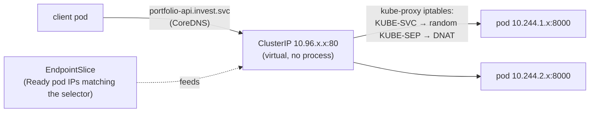

- **Service** = a stable virtual IP + DNS name in front of changing pod IPs. Ranges: Services `10.96.0.0/16`, pods `10.244.0.0/16`.
- **EndpointSlice** lists the Ready pods behind it. No Ready pods → kube-proxy REJECTs → `connection refused` (curl exit 7). DNS failure is a different error (exit 6).
- **Headless Service** (`clusterIP: None`): no virtual IP; DNS returns pod IPs and gives StatefulSet pods stable names (`vault-0.vault-internal`).
- `kubectl port-forward` tunnels **through the API server** (RBAC `pods/portforward`).

---

## 7. Storage: PVC, PV, StorageClass

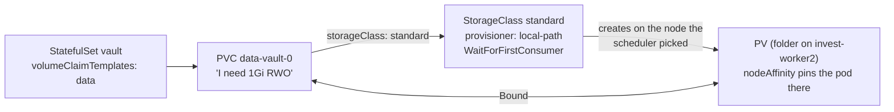

- **PVC** = a request (namespaced). **PV** = actual storage (cluster-wide). **StorageClass** = how to create PVs on demand. App YAML stays portable; only the StorageClass changes between kind and EKS (EBS).
- **WaitForFirstConsumer**: the scheduler places the pod first, then the volume is created on that node / in that AZ. After that, the volume pins the pod.
- PVC name = `<template>-<statefulset>-<ordinal>` → `data-vault-0`. A replaced `vault-0` gets the same PVC back.
- Deleting a StatefulSet keeps its PVCs (Kubernetes doesn't garbage-collect your data). Reclaim policy `Delete` vs `Retain` decides what happens to the PV when the PVC is deleted.
- local-path volumes are plain 0777 folders on one node: fine for a laptop, no node-failure tolerance.
- **Wiping a StatefulSet's disk on purpose** ("factory reset"): scale to 0 first (a PVC in use can't be removed: the `kubernetes.io/pvc-protection` finalizer waits), then delete the PVC. With reclaim `Delete` the PV and the node folder vanish too. No undo. Scale back up → a brand-new empty PVC from the template.
- A PV is **not a pod**. It's a record describing a piece of storage (here, a folder on a node).

---

## 8. Images and the supply chain

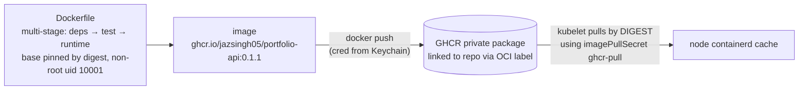

- **Tag vs digest:** a tag can be moved to another image; a digest (`@sha256:…`) can't. Deploy by digest.
- Short names expand to `docker.io/library/...`, a supply-chain risk.
- **Layer cache is a chain:** changing step N rebuilds N+1 onward. Put slow, stable steps (base, dependencies) first.
- `docker login` without a credential helper stores `base64(user:token)` in `~/.docker/config.json`. With `credsStore: osxkeychain` the file holds no secret.
- **Registry token flow:** containerd asks `ghcr.io/token?scope=repository:…:pull` for a short-lived bearer token. Anonymous → 401 for a private package; with the pull secret → Basic auth → token → download.
- Each node pulls and caches separately (`IfNotPresent`: no pull if cached). A running container doesn't need its image anymore (it runs from an unpacked snapshot).
- **Publisher credential ≠ cluster credential:** laptop gh token has `write:packages`; the cluster's Personal Access Token (PAT) has only `read:packages` and expires.

**Image policy: every image comes from our GitHub Container Registry (GHCR), pinned by digest.**

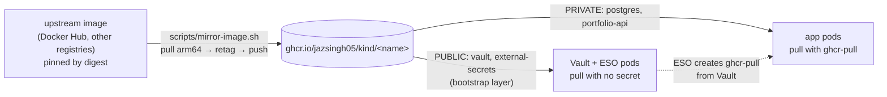

- **Why mirror:** one registry we control, a digest we chose, no dependence on Docker Hub limits or outages, and one allow-list for Kyverno (step 9).
- **Why Vault and the External Secrets Operator (ESO) are public:** chicken-and-egg. ESO *creates* the pull secret, so ESO's own image (and Vault's, which ESO needs) can't require it. They're unmodified upstream images, so public leaks nothing. On EKS the problem disappears: nodes pull from Elastic Container Registry (ECR) with their IAM role, no pull secret.
- **Single-arch copy = new digest** (old method). Upstream digests usually point at a multi-arch *index*; re-pushing only the arm64 image gives a different digest.
- **Mirror registry-to-registry with `crane copy`** (since 2026-11-09). The bytes are copied as-is, never unpacked locally, so **mirror digest == upstream digest**: verifying = comparing two equal hashes, and the vendor's signatures stay valid on our copy. The old `docker pull/tag/push` broke on Docker's containerd image store, which keeps unpacked *snapshots* of shared layers but drops their compressed blobs, so a push of an image sharing layers with one already present fails with `content digest … not found`.
- **Mirroring pays off during outages:** quay.io was down ~20 min while we mirrored. Pods pulling from our GHCR wouldn't notice; anything pulling from quay.io would hit `ImagePullBackOff` on its next restart.
- **One pull secret per namespace.** Secrets are namespaced, so each namespace pulling private images needs its own `ghcr-pull` from its own ESO pipeline, with a Vault role whose policy (`ghcr-pull-read`) reads that one path only.
- **Pinning through Helm:** both charts render `repository:tag`, so the digest rides in the tag: `tag: "2.0.4@sha256:…"`. ESO uses one image in 3 Deployments → a YAML anchor (`&esoImage` / `*esoImage`) keeps them identical.
- Exception: Kubernetes system images built into the kind node image (kube-apiserver, etcd, CoreDNS, kindnet, local-path-provisioner).

---

## 9. TLS, certificates and CAs

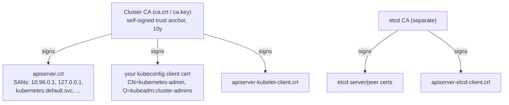

- A **certificate** = a CA-signed statement "this public key belongs to this name". Like a JWT, but for keys.
- **Verifying a cert:** signature by a trusted CA + valid dates + the name you dialed is in the **SAN** list + the server proves it holds the private key.
- **mTLS** = both sides show certs. kubectl ↔ API server, API server ↔ kubelet, API server ↔ etcd are all mTLS.
- The same CA cert is in three places: the node's `pki/` (created by `kubeadm init`), the `kube-root-ca.crt` ConfigMap in every namespace (projected into every pod as `ca.crt`), and your kubeconfig. The CA cert is public; **`ca.key` is the crown jewel** (mint any user). K8s client certs **can't be revoked**.
- `openssl s_client` without the CA → "unable to verify" (code 21). Never skip verification (`-k`, `insecureSkipTLSVerify`).

---

## 10. Identity: kubeconfig, ServiceAccounts, JWTs

- **kubeconfig** = clusters (URL + CA) + users (client cert or token) + contexts. Your user is a cert in group `kubeadm:cluster-admins` → bound to `cluster-admin`. `system:masters` is break-glass only.
- **ServiceAccount** = an identity for workloads. Its tokens are **JWTs** signed by the API server's `sa.key`.
- **JWT** = `header.payload.signature`. The payload is readable by anyone (`iss`, `sub`, `aud`, `exp`, `jti`, SA `uid`); the signature makes it tamper-proof. It's a **bearer token**: whoever holds it is that identity until `exp`.
- **TokenRequest** (`kubectl create token`) mints short-lived, **audience-bound** tokens. Deleting and recreating an SA changes its UID and revokes all its old tokens.

---

## 11. Secrets pipeline: Vault + External Secrets Operator

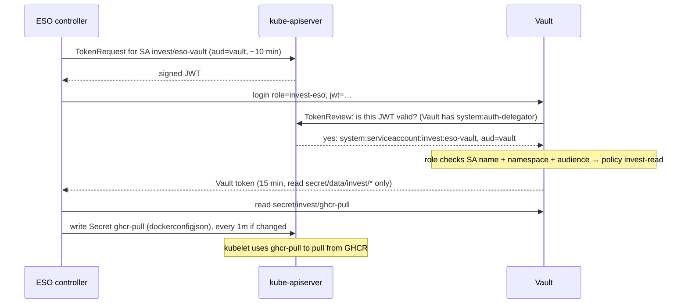

- **Vault:** standalone StatefulSet; KV v2 at `secret/` (versioned; real API path has `/data/`). Starts **sealed** after every restart; unseal key + root token live in macOS Keychain, never printed. Production: HA + **auto-unseal with KMS**.
- **No secret zero:** ESO never holds a long-lived Vault credential. It proves identity with a cluster-signed JWT; Vault asks the cluster to verify it. Same pattern as EKS Pod Identity / IRSA and GitHub Actions OIDC.
- **Client names the role, server decides the policy.** The SecretStore says `role: invest-eso`; Vault attaches `invest-read`. Clients can't pick their own permissions.
- **Per-namespace tenancy:** namespaced `SecretStore` + dedicated SA `invest/eso-vault` + Vault path `secret/invest/*` + policy `invest-read`. Not ESO's own SA, which would let any namespace read anything.
- **`audience=vault`:** a token minted for the k8s API (like the one auto-mounted in pods) is rejected by Vault → no replay.
- **Trust is transitive:** whoever can mint a token for `invest/eso-vault` can read `secret/invest/*`. Guard `serviceaccounts/token` and pod creation.
- **ExternalSecret** fetches `username` + `token` and templates them into Docker's `config.json` format (`kubernetes.io/dockerconfigjson`), the only format kubelet accepts for pull secrets. ESO only writes when the data hash changes.

---

## 12. etcd and encryption at rest

- **etcd** = the cluster's key-value database. Keys look like `/registry/<resource>/<namespace>/<name>`. Lose it and the cluster forgets everything; back it up.
- By default Secrets in etcd are **base64, not encrypted**. Reading etcd directly (node root, etcd client certs, a backup file) shows every Secret, with no RBAC or audit in the way.
- **Encryption at rest:** an `EncryptionConfiguration` makes the API server encrypt Secrets before writing them (`k8s:enc:secretbox:v1:key1:…` in etcd). `scripts/enable-etcd-encryption.sh` does this with a local key; the key sits on the node, so it protects backups and snapshots, not node root.

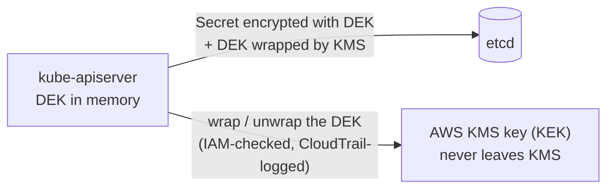

- **On EKS: envelope encryption with your own KMS key.** A data key (DEK) encrypts Secrets; the KMS key (KEK) wraps the DEK and never leaves KMS. Stealing etcd isn't enough; you also need IAM permission to call KMS. Disabling the key makes the data unreadable.
- **Encryption at rest protects storage, not the API.** Anyone with RBAC `get`/`list` on Secrets still reads them decrypted. `list` returns full contents too.
- Full picture: **ESO** = distribution + rotation, **KMS** = storage, **RBAC + audit** = access.

---

## 13. Extending Kubernetes: Helm, CRDs, admission webhooks

- **Helm chart ≈ Terraform module:** templates + `values.yaml` defaults; you pass your own values and pin `--version`. Helm tracks a **release** (stored as a Secret) so upgrades remove dropped objects and rollbacks work. `helm install --dry-run=server` validates against the API server without changing anything.
- **Our app = plain YAML + kubectl** (to learn the objects). **Third-party software = Helm** (ESO is ~34k lines rendered). Our own chart comes in step 7.
- **Namespaces are owned by YAML files**, not `helm --create-namespace`, so they can carry labels (Pod Security Admission later).
- **CRD = a new noun, controller = the verb.** ESO added 25 CRDs (`SecretStore`, `ExternalSecret`, …). A CRD object on its own is just data in etcd; the controller gives it behavior and writes its `status`.
- **Validating admission webhook:** the API server calls it (over TLS) before saving an object. ESO's uses `failurePolicy: Fail` = fail-closed: if the webhook is down, writes to ESO objects are rejected. Status updates and syncing keep working. Run webhooks with 2+ replicas and a PDB, and keep their scope narrow.

---

## 14. Break-it log

| Broke | What happened | Lesson |
|---|---|---|
| Deleted a pod | ReplicaSet made a new one | Controllers enforce desired count |
| Bare pod deleted | Gone for good | Never run bare pods |
| Image not on nodes | `ImagePullBackOff` | kubelet retries with backoff |
| Scaled to 0 | Service REJECTs (exit 7) | No Ready endpoints = no traffic |
| Private image, no pull secret | 401 from GHCR token endpoint; old pods kept serving | Rollouts don't remove capacity until new pods are Ready |
| Vault sealed | ESO not Ready, existing Secret kept, app fine | Vault down = refresh outage, not app outage; alert on `READY False` |
| Vault unsealed | ESO stayed broken for minutes | Exponential backoff; nudge (annotate) or restart the controller |
| Rotated the token | Synced in <1 min; forced pull on a cache-less node worked; old PAT revoked | Zero-downtime rotation: add new → verify → revoke old |
| Deleted Secret `ghcr-pull` | Recreated in the same second | Owned Secrets are watched; Vault is the source of truth |
| ESO webhook scaled to 0 | Writes to ESO objects rejected | Fail-closed admission is an availability dependency |
| Read etcd directly | Token in plaintext | Enable encryption at rest (KMS on EKS) |
| `rollout undo` | Old ReplicaSet scaled up as a new revision; git ≠ cluster | Emergency button; then make git match |
| Killed `postgres-0` (twice) | Same name, same node, new IP, data intact | StatefulSet identity + PVC follow the pod; never hard-code pod IPs |
| Deleted Postgres PVC on purpose | PV and node folder gone; new pod got a fresh empty disk | Reclaim `Delete` = no undo; production uses `Retain` or snapshots |
| Probe without `-d` | Probe PASSED while Postgres logged a FATAL every 5s | Green probe ≠ correct probe; read the app's logs |
| App user tried to escalate | CREATE ROLE, ALTER ROLE SUPERUSER, CREATE DATABASE, write to `public`, read `pg_authid`: all denied | Least privilege proven by attack, not by claim |
| `helm upgrade` Vault | Template updated, pod untouched (`OnDelete`); deleted pod came back sealed | An upgrade is a seal event → auto-unseal (KMS) in production |
| cert-manager's identity asked Vault for the Postgres password | Logged in fine, then `403 permission denied`; no Secret created | Authentication ≠ authorization: scope each role's policy to exactly what it needs |
| Renamed a header in the live ConfigMap | Pod file changed ~1–3 min later, no restart; logs clean until a request, then 500 `missing required columns`; pods stayed 1/1 | Config errors hide until traffic hits them; a meaningful readiness probe would catch it (step 6) |
| Re-applied from git | The two pods recovered ~20s apart | Live config updates aren't simultaneous: the Service served mixed answers |

---

## 15. Security one-liners (interview)

- "Workloads authenticate with platform-issued, audience-bound, short-lived identity tokens; no static credentials anywhere."
- "The client asserts identity; the server decides permissions."
- "ESO solves distribution and rotation, KMS envelope encryption solves storage, RBAC plus audit solves access. You need all three."
- "Labels are routing, not identity."
- "Every pod gets an API token by default; turn it off where it isn't needed."
- "Pin images by digest; tags are mutable."
- "`ca.key`, `etcd/ca.key` and `sa.key` on a control-plane node are game over. That's why managed control planes hide them."
- "Fail-closed admission is secure but becomes an availability dependency."
- "The database bootstrap superuser is break-glass; the app gets a role with no attributes and one schema."
- "Config in ConfigMaps, secrets in Secrets: if seeing it would hurt, it doesn't go in a ConfigMap."
- "Mount secrets as files, not env vars: env vars leak into child processes and crash dumps, and Secret volumes live in RAM."
- "The root of a trust chain can't depend on the chain: bootstrap components pull without the secret they create."
- "Mirror images byte-for-byte: same digest as upstream means you can still verify the vendor's signature."
- "A valid identity gets you in the door; the policy decides what you can touch."
- "Fail loudly on bad config: a crash is better than a confident wrong number."

---

## 16. Command cheat sheet

```bash
# cluster / state
kubectl get nodes -o wide
kubectl get all -n invest
kubectl describe pod <pod> -n invest          # Events at the bottom explain most failures
kubectl get events -n invest --sort-by=.lastTimestamp
kubectl diff -f <file> && kubectl apply -f <file>

# rollouts
kubectl rollout status|history|undo deployment/portfolio-api -n invest

# nodes
kubectl cordon|uncordon <node>
docker exec <node> crictl images              # node-level view under k8s

# Vault (after every colima start)
security find-generic-password -a vault -s kind-invest-vault-unseal -w | tr -d '\n' \
  | kubectl exec -i -n vault vault-0 -- vault write sys/unseal key=-

# ESO
kubectl get secretstore,externalsecret -n invest
kubectl annotate externalsecret ghcr-pull -n invest force-sync=$(date +%s) --overwrite

# Postgres (admin over the local socket; values read inside the pod)
kubectl exec -it postgres-0 -n invest -- sh -c 'psql -U "$(cat /run/secrets/postgres-admin/username)" -d portfolio -c "\du" -c "\dn"'
kubectl logs postgres-0 -n invest | grep -E 'FATAL|running /docker-entrypoint'

# Helm
helm upgrade <release> <chart> --version <pinned> -n <ns> -f <values.yaml>
helm history <release> -n <ns>
helm template <release> <chart> --version <pinned> -f <values.yaml> | grep image:   # render locally, check before upgrading
```

zsh tip: single-quote any argument containing `[ ]`, `?` or `*` (jsonpath, custom-columns).

---

## 17. Postgres: ConfigMaps, volumes, least-privilege users

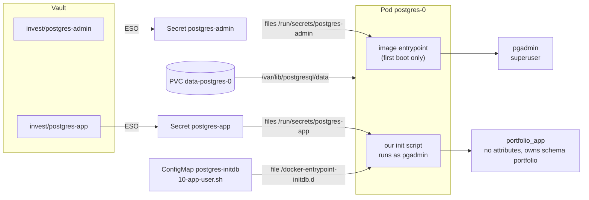

**ConfigMap** = non-secret config kept outside the image, as key → value pairs. A value can be a short string or a whole file. Change config without rebuilding the image.

| | ConfigMap | Secret |
|---|---|---|
| For | settings, scripts, mappings | passwords, tokens, keys |
| `kubectl describe` | shows values | hides values |
| Role-Based Access Control (RBAC) | usually readable broadly | lock down `get`/`list` |
| etcd | plaintext | plaintext unless encryption at rest is on |

**`volumes` vs `volumeMounts`:**
- `volumes:` (pod level): *what* the data is and *where it comes from*: a PersistentVolumeClaim (PVC), a Secret, a ConfigMap. Given a name.
- `volumeMounts:` (per container): *where* it appears inside that container. Refers to the volume by name.
- Only the PVC volume is a real disk. Secret and ConfigMap volumes are files the kubelet writes from the API object; Secret volumes live in RAM (tmpfs). Each key becomes one file. `defaultMode` sets file permissions (`0440` secrets, `0555` scripts).
- In a StatefulSet, the `data` volume isn't listed under `volumes:`: `volumeClaimTemplates` adds it automatically.
- Mounted ConfigMap files update inside a running pod (about a minute); env vars from a ConfigMap never do.

**How the two users are made (first boot on an empty disk only):**
1. The official image reads `POSTGRES_USER_FILE`, `POSTGRES_PASSWORD_FILE`, `POSTGRES_DB_FILE` (the `_FILE` variants read the value from a mounted file), runs `initdb`, makes that user **superuser**, and creates the database.
2. It then runs every script in `/docker-entrypoint-initdb.d/`. Ours logs in as the admin and creates `portfolio_app` with every power off (`NOSUPERUSER NOCREATEDB NOCREATEROLE NOREPLICATION NOBYPASSRLS`), revokes `CONNECT` from everyone else, gives it its own schema, and locks `public`. Passwords are read by psql from the Secret files, never in argv.
3. Later boots see an existing data directory and skip both steps ("Skipping initialization"). To rerun them you must wipe the PVC.

**Naming across layers:** Vault path `invest/postgres-app` → Kubernetes Secret `postgres-app` (the envelope) → database user `portfolio_app` (the name written inside it).

**Least privilege, tested:** as `portfolio_app` over TCP with its password: creating a table in its own schema works; creating roles, promoting itself, creating databases, writing to `public` and reading password hashes (`pg_authid`) are all denied. Only the Postgres container ever gets the admin Secret; portfolio-api will get only `postgres-app`.

**Readiness probe lesson:** `pg_isready -U pgadmin` without `-d` tries a database named `pgadmin`. The probe still passes (any server reply counts), but Postgres logs a FATAL every 5s. Always name the database.

---

## 18. Live config: the sheet header map

**Why:** his sheet's column names are *his*; the code uses *ours*. The map (header → field) lives in ConfigMap `portfolio-api-header-map`, so when the real sheet arrives, a renamed column is a config edit, not a code change, image build and rollout.

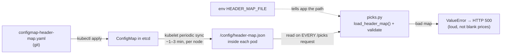

- **The path is ours to choose:** `volumeMounts.mountPath: /config` places the folder; the ConfigMap key `header-map.json` names the file; the env var `HEADER_MAP_FILE` tells the app. Nothing checks that these agree. (Postgres's `/docker-entrypoint-initdb.d` was the image's choice, not ours.)
- **Mounted files update in running pods; env vars never do.** The app re-reads the file on each load, so an edit goes live with no restart.
- **How updates stay atomic:** the mount is a timestamped folder `..2026_11_07_…/`, a symlink `..data` pointing at it, and `header-map.json -> ..data/header-map.json`. An update writes a new folder and swaps the symlink in one rename, so the app sees all-old or all-new, never half a file.
- **`subPath` gotcha:** mounting a single file with `subPath` binds that file directly, so it never sees the symlink swap: **subPath mounts never update**.
- **Not instant, not simultaneous:** each node's kubelet syncs on its own schedule. During the window, pods behind one Service disagree.

| | Live file update | `kubectl rollout restart` (or config hash in the template) |
|---|---|---|
| Speed | 1–3 min, no restart | seconds per pod |
| Consistency | pods disagree for a while | each pod is one version; new pods must pass readiness |
| Safety net | none: bad config hits running pods | readiness probe can stop a bad rollout |

- **Drift:** a hand-edit (`kubectl edit`, k9s `e`, `get | sed | apply`) makes cluster ≠ git. The fix is re-applying git; Argo CD (step 7) does that automatically.
- **Order:** apply the ConfigMap before the Deployment; a missing ConfigMap leaves the pod in `ContainerCreating`.
- `defaultMode: 420` in the API output is decimal for octal `0644`.

---

## 19. TLS to Postgres, simply: the ID badge system (plan)

**Transport Layer Security (TLS)** gives three things: the traffic is **encrypted**, can't be **tampered with**, and the client can **prove** who it's talking to. The proof is the part that matters: encrypting a connection to an impostor protects nothing.

| Real world | Our version | Job |
|---|---|---|
| Badge office | **cert-manager** | prints badges, replaces them before they expire |
| Official stamp | **our Certificate Authority (CA)** `invest-ca` | proves a badge is real; only the badge office has it |
| Badge | **certificate** | "I am `postgres.invest.svc`", stamped by the CA |
| Badge's secret PIN | **private key** | proves the holder owns the badge; never shared |
| List of real stamps | **`ca.crt`** | lets anyone check a stamp is genuine |

**How it connects**

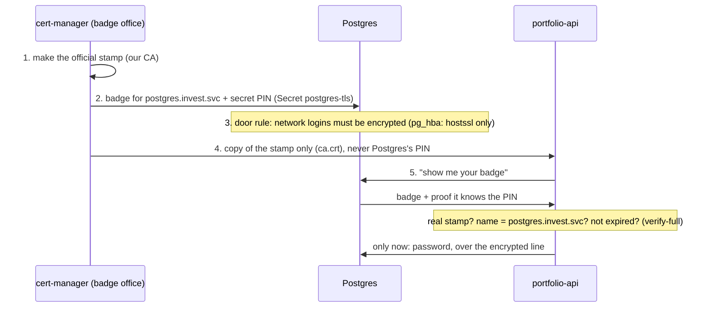

Anything off (fake stamp, wrong name, expired badge, or an attempt to talk without encryption) → refused.

**Why both sides check**
- **Postgres refuses unencrypted callers** → a careless or misconfigured app can't send its password in the clear.
- **The app refuses unverified servers** → an impostor pretending to be Postgres can't collect passwords.
- One side alone leaves a hole; both together = locked.

**What we build, in order**
1. **Install the badge office**: cert-manager via Helm, its images mirrored to our GHCR first.
2. **Create the official stamp**: a self-signed root CA + ClusterIssuer `invest-ca`.
3. **Order Postgres's badge**: Certificate `postgres-tls` with the names clients dial as Subject Alternative Names (SANs), e.g. `postgres.invest.svc`.
4. **Turn on encryption + put up the door rule**: Postgres `ssl=on`; `pg_hba.conf` (Postgres's access rules) from a ConfigMap via `-c hba_file=…`, with `hostssl` only for network logins. Not edited on the PersistentVolumeClaim (PVC): that would be drift outside git.
5. **Test the door**: unencrypted login (`sslmode=disable`) → rejected; encrypted works; dialing the pod IP with `verify-full` → rejected (not a SAN).
6. **Connect the app**: give it the stamp copy (`ca.crt`) and the `postgres-app` login as files; `sslmode=verify-full` + `sslrootcert`; a `/readyz` readiness check so Kubernetes knows when the app can't reach the database (no database check in liveness, or a database blip restarts every app pod).

**Client `sslmode`, from worst to right:** `disable` (plaintext) → `prefer` (Postgres's default: silently falls back to plaintext) → `require` (encrypts, trusts any cert) → `verify-ca` (any cert from our CA) → **`verify-full`** (our CA *and* the right name). We use `verify-full`, never lower.

**The one thing to protect:** the stamp, meaning the CA's private key. Whoever has it can print fake badges for *any* service. In step 9, Role-Based Access Control (RBAC) keeps almost everyone away from it; in production the root lives in a Hardware Security Module (HSM) or AWS Private CA, not in the cluster.

**Later:** Vault as the CA behind cert-manager; mutual TLS (mTLS), where the app shows a badge too; NetworkPolicy (step 5) so only portfolio-api can reach port 5432.
